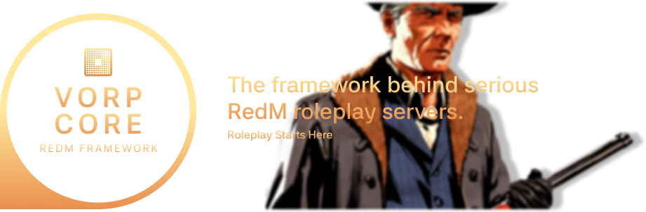

    

This organization hosts the **core framework**, along with **official resources and tools** that power and extend the VORP ecosystem.
It provides a **robust and scalable foundation** for developers looking to build, customize, and maintain a RedM roleplay server with a long-term vision and structured development workflow.

At the same time, VORP is also accessible to **beginners**, making it a great choice for those who want to create their own server without prior technical knowledge.
Today, it is trusted and used by more than **1,000+ server owners worldwide**.

## Official Team

Development of VORP is led by a dedicated team of volunteers who are passionate about creating a **high-quality framework** for the RedM community. The team is responsible for maintaining the **core framework**, developing **official resources**, and providing support to users.
- [Blue](https://github.com/kamelzarandah) — Owner
- [Outsider](https://github.com/outsider31000?tab=repositories) — Project Manager
- [Blackpegasus](https://github.com/creativewild) — VORP Dev Team

## Community

Join our **community of developers, server owners, and roleplay enthusiasts** to share ideas, get support, and stay updated on the latest news and developments related to VORP.

    
    

## License

VORP is licensed under the [**GNU General Public License v2.0 or later**](../LICENSE). If you redistribute modified versions of the project, you must keep them under the same license terms and preserve the original notices.

    Some visual assets may reference Rockstar Games, Red Dead Redemption 2, and RedM. VORP is an independent project and is <strong>not approved, sponsored, or endorsed by Rockstar Games</strong>. All trademarks, logos, and copyrighted materials remain the property of their respective owners.

